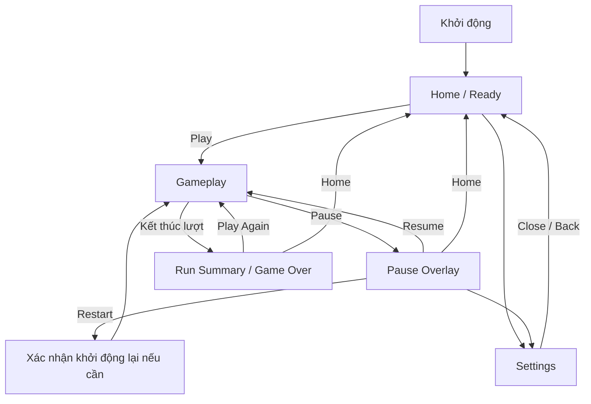

# UI/UX Agent Guide — Arcade Match-3 Game

> **Mục đích:** Đây là tài liệu chuẩn để coding agent thiết kế, triển khai và kiểm thử UI/UX cho game arcade match-3 chạy trên React + Canvas. Agent phải xem đây là design/UX contract, không phải gợi ý tùy chọn.
>
> **Bối cảnh dự án:** Game casual arcade lấy cảm hứng từ cơ chế match-3 cổ điển: người chơi đổi vị trí hai block kề nhau; ghép từ 3 block trở lên theo hàng ngang hoặc dọc để ghi điểm. Trải nghiệm hướng đến desktop và mobile. Phong cách block: flat, rõ ràng, hình khối đá quý; mỗi loại được nhận biết bằng **cả màu sắc lẫn hình dáng**. Không dùng nhân vật làm trung tâm trải nghiệm. Nếu codebase hiện có quy tắc gameplay khác với mô tả này, giữ nguyên luật đã được xác nhận và hỏi lại bằng một câu hỏi cụ thể chỉ khi xung đột đó chặn việc triển khai.

---

## 1. Vai trò của agent

Bạn chịu trách nhiệm như một nhóm nhỏ gồm **Game UX Designer, UI Designer, Interaction Designer và Frontend Engineer**.

Kết quả cần đạt:

1. Người chơi hiểu mục tiêu và cách thao tác mà không cần đọc hướng dẫn dài.
2. Có thể bắt đầu lượt chơi nhanh, thao tác chính xác trên chuột và cảm ứng.
3. Mọi thao tác đều có phản hồi dễ hiểu; không để người chơi nghi ngờ game có nhận input hay không.
4. Bảng game luôn là trọng tâm; HUD và hiệu ứng không che khuất thông tin quan trọng.
5. UI nhất quán, responsive, có thể truy cập ở mức hợp lý và không phụ thuộc riêng vào màu sắc.
6. Animation làm rõ trạng thái và tăng cảm giác thỏa mãn, không làm chậm nhịp chơi.
7. Code có thể bảo trì, hiệu năng ổn định và có tiêu chí nghiệm thu cụ thể.

### Thứ tự ưu tiên khi có xung đột

1. Tính đúng đắn của gameplay và dữ liệu trạng thái.
2. Tính rõ ràng của thao tác và phản hồi.
3. Khả năng sử dụng trên mobile/desktop.
4. Khả năng đọc, accessibility và hiệu năng.
5. Độ đẹp, độ cầu kỳ và hiệu ứng trang trí.

Không hy sinh 1–4 để đổi lấy hiệu ứng bắt mắt.

---

## 2. Nguyên tắc UX không được vi phạm

### 2.1. Game trước, giao diện sau

- Khu vực board là tiêu điểm thị giác lớn nhất trong lúc chơi.
- HUD chỉ hiển thị chỉ số giúp người chơi hiểu tiến độ hoặc kết quả của lượt hiện tại.
- Không đặt banner, thông báo, nút phụ hoặc hiệu ứng trang trí lên vùng người chơi cần quan sát block.
- Không hiển thị nhiều chỉ số chỉ vì có thể tính được chúng.

### 2.2. Phản hồi ngay lập tức

- Phản hồi input trực quan nên bắt đầu trong khoảng **100 ms** sau thao tác hợp lệ, trừ khi thiết bị đang quá tải.
- Thể hiện rõ ít nhất ba trạng thái: đang được chọn/kéo, thao tác hợp lệ, thao tác không hợp lệ.
- Nếu thao tác không hợp lệ, trả block về vị trí ban đầu và dùng tín hiệu ngắn, dễ hiểu; không chỉ đơn thuần bỏ qua input.
- Mỗi hành động chỉ tạo một phản hồi chính. Tránh rung, nháy, chữ bay, âm thanh và hạt hiệu ứng cùng lúc ở cường độ cao.

### 2.3. Giảm tải nhận thức

- Mỗi màn hình có một hành động chính nổi bật.
- Dùng từ ngắn, quen thuộc; tránh thuật ngữ kỹ thuật trong UI.
- Hướng dẫn theo ngữ cảnh, từng bước, bằng hình ảnh động ngắn thay vì một khối văn bản dài.
- Không bắt người chơi ghi nhớ trạng thái trước đó để hiểu màn hình hiện tại.

### 2.4. Công bằng và dễ dự đoán

- Block cùng loại phải có hình dáng, màu và quy tắc tương tác nhất quán.
- Không đổi vị trí/nội dung block theo cách khiến người chơi hiểu nhầm rằng input của họ bị bỏ qua.
- Không dùng hiệu ứng giả để che việc thao tác không được xử lý.
- Không dùng dark pattern, quảng cáo tự bật, nút xác nhận gây hiểu lầm hoặc cố ý gây khó để ép người chơi chơi tiếp.

### 2.5. Giữ nhịp arcade

- Khởi động ván nhanh; không có chuỗi màn chờ hoặc intro dài không thể bỏ qua.
- Animation quan trọng phải ngắn, rõ và có thể hoàn tất trong nhịp chơi.
- Không khóa input lâu hơn mức cần thiết để bảo đảm tính đúng đắn của chuỗi match/cascade.
- Khi board đang xử lý chuỗi hiệu ứng, thể hiện rõ trạng thái đang giải quyết; không khiến thao tác bị mất một cách âm thầm.

---

## 3. Luồng màn hình và thông tin kiến trúc

### 3.1. Sơ đồ luồng mặc định



Sửa luồng nếu game hiện có một mode khác, nhưng không thêm màn hình chỉ để làm giao diện trông nhiều tính năng hơn.

### 3.2. Home / Ready

**Mục tiêu:** Người chơi nhận ra game và bắt đầu trong một thao tác.

Thứ tự ưu tiên:
1. Tên/logo game.
2. Nút chính `Play` hoặc `Continue` nếu game thực sự hỗ trợ tiếp tục.
3. Best score hoặc thành tích có giá trị với người chơi.
4. Nút Settings và các hành động phụ cần thiết.

Quy tắc:
- Không buộc người chơi đi qua tutorial mỗi lần mở game.
- Nếu đây là lần chơi đầu, có thể dùng một gợi ý ngắn gần nút Play; không che CTA.
- Không thêm nhân vật/mascot làm trung tâm mặc định.
- Không hiển thị thống kê rỗng hoặc giả lập như thể đó là dữ liệu thật.

### 3.3. Gameplay

**Mục tiêu:** Người chơi tập trung vào board và hiểu trạng thái của lượt chơi.

HUD tối thiểu:
- **Score:** điểm của lượt hiện tại.
- **Best:** điểm tốt nhất, nếu tính năng lưu thành tích có tồn tại.
- **Combo/Multiplier:** chỉ hiển thị nếu đây thực sự là cơ chế gameplay.
- **Pause:** dễ nhận biết, không nằm sát vùng thao tác block.
- **Timer/Goal/Progress:** chỉ dùng đúng loại phù hợp với mode hiện tại; không hiển thị đồng thời nhiều chỉ số không cần thiết.

Quy tắc:
- Số điểm tăng đồng bộ với sự kiện ghi điểm; không tăng sớm trước khi match được xác nhận.
- Có quy tắc format nhất quán cho số lớn, ví dụ `12,450` hoặc `12.450`; chọn một cách theo locale của sản phẩm.
- Board không bị kéo méo khi viewport thay đổi.
- Không đặt nút điều hướng thường xuyên ở nơi dễ bị chạm nhầm trong lúc chơi.

### 3.4. Pause overlay

Thành phần theo thứ tự:
1. Tiêu đề `Paused`.
2. Nút chính `Resume`.
3. Nút phụ `Restart`.
4. Nút `Settings` nếu cần.
5. Nút `Home`.

Quy tắc:
- Overlay đủ tương phản để báo game đang tạm dừng nhưng vẫn giữ được ngữ cảnh board.
- Khi pause, dừng timer và animation gameplay phù hợp; không chỉ che board bằng UI.
- `Resume` là hành động nổi bật nhất.
- Nếu restart làm mất tiến trình hiện tại, yêu cầu xác nhận ngắn hoặc đưa ra quy tắc rõ ràng trước khi thực hiện.

### 3.5. Run Summary / Game Over

Thông tin theo thứ tự:
1. Trạng thái kết thúc rõ ràng.
2. Score của lượt vừa chơi.
3. Best score hoặc chỉ báo kỷ lục mới, nếu có dữ liệu thật.
4. Nút chính `Play Again`.
5. Nút phụ `Home`.

Quy tắc:
- Tôn vinh kết quả mà không làm người chơi đợi quá lâu.
- Nếu phá kỷ lục, dùng một tín hiệu đặc biệt nhưng không lấn át điểm số.
- Không tạo cảm giác thất bại nặng nề bằng màu sắc, âm thanh hoặc câu chữ mang tính phán xét.
- Có thể lưu thành tích cục bộ nếu đây là yêu cầu sản phẩm, nhưng phải xử lý trường hợp dữ liệu chưa tồn tại hoặc bị lỗi.

### 3.6. Tutorial lần đầu

- Hướng dẫn tối đa một thao tác chính mỗi bước.
- Dùng highlight vùng thao tác và animation minh họa ngắn.
- Chỉ hiển thị thông tin cần dùng ngay tại thời điểm đó.
- Cho phép bỏ qua khi phù hợp; nếu gameplay cần tutorial bắt buộc, hướng dẫn phải ngắn và không lặp lại vô ích.
- Kết thúc tutorial phải chuyển thẳng vào chơi, không thêm một chuỗi xác nhận nữa.

### 3.7. Settings

Chỉ đưa vào những cài đặt game hỗ trợ thực sự, ví dụ:
- Music: On/Off.
- Sound effects: On/Off.
- Vibration/haptics: On/Off, nếu có hỗ trợ.
- Reduced motion hoặc hiệu ứng thấp, nếu triển khai được.
- Language, nếu sản phẩm có nhiều ngôn ngữ.

Không làm cài đặt trở thành một dashboard. Thay đổi cần có phản hồi ngay và trạng thái phải được lưu đúng theo phạm vi đã chọn.

---

## 4. UX cho board và block

### 4.1. Định hướng thị giác

- Phong cách **flat, sạch, rõ khối**, gợi cảm giác đá quý arcade nhưng không cần mô phỏng vật liệu 3D nặng.
- Mỗi loại block có một màu chính và một silhouette/glyph khác biệt. **Không chỉ dựa vào màu sắc** để phân biệt.
- Các block có cùng kích thước ô, khoảng cách đều và vùng tương tác dễ đoán.
- Highlight và đường viền không được làm silhouette của block biến dạng đến mức khó nhận diện.
- Hạn chế texture, glow và particle nếu chúng làm giảm độ rõ của board.
- Không sao chép nguyên xi tên, logo, sprite, âm thanh hoặc bố cục độc quyền của một game tham chiếu; tạo tài sản và nhận diện riêng.

### 4.2. Ngữ nghĩa trạng thái block

Mỗi trạng thái phải có tín hiệu trực quan riêng, không chỉ dựa vào thay đổi màu nhẹ:

| Trạng thái | Phản hồi mong đợi | Điều cần tránh |
|---|---|---|
| Idle | Hình khối ổn định, tương phản tốt | Glow liên tục làm board nhiễu |
| Hover (desktop) | Viền/highlight nhẹ, phản hồi tinh tế | Phóng to quá mức khiến lưới rung |
| Selected | Viền rõ, tăng scale nhẹ hoặc nâng lớp | Chỉ đổi một chút sắc độ khó nhận ra |
| Dragging | Block theo con trỏ/ngón tay, có giới hạn hợp lý | Block lệch khỏi con trỏ hoặc bị kéo méo |
| Valid swap | Hai block đổi vị trí mượt, điểm đến dễ theo dõi | Teleport không có chuyển tiếp |
| Invalid swap | Trở về vị trí cũ với rung/nhún ngắn | Không phản hồi hoặc rung mạnh kéo dài |
| Match pending | Dấu hiệu dự báo rất ngắn | Nhấp nháy gây khó chịu |
| Matched | Pop/scale/fade hoặc hình ảnh biến mất rõ ràng | Hiệu ứng dài khiến khó đọc chuỗi match |
| Falling | Block di chuyển theo ô, dễ theo dõi | Quỹ đạo khó đoán hoặc xuyên qua block khác |
| Spawn | Xuất hiện rõ, đồng nhất với quy luật board | Flash sáng mạnh hoặc xuất hiện sai vị trí |
| Special/Cascade | Nhấn mạnh vừa đủ để phân cấp giá trị | Mọi match đều có hiệu ứng “tối đa” |

### 4.3. Tương tác trên desktop và mobile

- **Mobile:** ưu tiên swipe qua hai ô kề nhau. Có thể hỗ trợ tap chọn rồi tap ô kế bên nếu điều này giúp độ chính xác; không triển khai hai cách theo kiểu khiến người chơi không biết cách nào đang được dùng.
- **Desktop:** hỗ trợ click-drag hoặc click chọn rồi click ô kề bên; chọn một hành vi chính và giữ nhất quán.
- Nếu một lần swap không tạo match và luật game yêu cầu hoàn tác, phải hoàn tác rõ ràng. Không để board ở trạng thái trung gian.
- Khi pointer/touch rời xa vùng hợp lệ, xử lý hủy kéo một cách nhất quán.
- Không bắt người chơi chạm chính xác vào đường biên nhỏ giữa các ô.
- Ngăn double input trong lúc đang resolve match/cascade nếu input mới có thể làm hỏng trạng thái; nhưng phản hồi trạng thái khóa phải rõ, không giả vờ rằng thao tác đã được nhận.
- Không để thao tác trên board vô tình kích hoạt cuộn trang, chọn văn bản hoặc kéo ảnh trình duyệt. Chỉ vô hiệu hóa hành vi trình duyệt trong vùng game cần thiết; không khóa toàn bộ trang một cách tùy tiện.

### 4.4. Hướng dẫn nước đi

- Hint chỉ xuất hiện khi game có cơ chế hint rõ ràng hoặc người chơi đang mắc kẹt theo quy tắc xác định.
- Hint phải làm nổi bật một hành động cụ thể, không nhấp nháy cả board.
- Không che block liên quan bằng tooltip dài.
- Không tự chơi thay người chơi nếu đây không phải tính năng sản phẩm.

---

## 5. Motion design và animation

### 5.1. Nguyên tắc

Animation có nhiệm vụ giải thích **điều gì vừa xảy ra**, **điểm nào quan trọng** và **người chơi có thể làm gì tiếp theo**. Đừng thêm chuyển động chỉ để lấp khoảng trống.

- Dùng easing nhất quán; tránh mọi chuyển động đều tuyến tính hoặc nảy quá mạnh.
- Animation thông thường nên ngắn. Hiệu ứng nhấn mạnh chỉ dành cho combo, cascade hoặc kỷ lục.
- Luôn có trạng thái cuối xác định; không để animation treo khi tab bị ẩn, component unmount hoặc game pause.
- Không cập nhật logic điểm số hoặc phát hiện match dựa trên frame animation. Gameplay state là nguồn sự thật; renderer chỉ trình bày state đó.
- Khi `prefers-reduced-motion` hoặc setting giảm chuyển động được bật, rút ngắn/loại bỏ chuyển động trang trí nhưng vẫn giữ tín hiệu trạng thái cần thiết.

### 5.2. Dải thời lượng khởi điểm

Đây là giá trị mặc định để agent thử nghiệm, không phải tiêu chuẩn cứng. Điều chỉnh theo cảm giác thực tế và đo trên thiết bị mục tiêu.

| Loại chuyển động | Khoảng thời lượng gợi ý |
|---|---:|
| Button press / tap feedback | 70–120 ms |
| Selected highlight | 80–140 ms |
| Swap hai block | 100–180 ms |
| Invalid swap / return | 100–180 ms |
| Match pop / disappear | 120–220 ms |
| Gravity / falling | 140–280 ms, tùy số ô |
| Spawn block | 100–180 ms |
| Score tick-up | 150–350 ms; không bắt buộc |
| Overlay vào/ra | 120–220 ms |
| Combo emphasis | 180–350 ms |

Tránh nối nhiều animation tuần tự không cần thiết. Nếu một cascade có nhiều chuỗi, ưu tiên nhịp rõ ràng và không kéo dài tổng thời gian quá mức.

### 5.3. Motion spec cần có khi triển khai

Với mỗi animation quan trọng, ghi rõ:
- Trigger.
- Các thuộc tính thay đổi: `x/y`, `scale`, `rotation`, `alpha`, `shadow/glow`.
- Duration và easing.
- Trạng thái đầu/cuối.
- Có thể interrupt hay không.
- Hành vi khi pause, tab hidden, restart hoặc reduced motion.
- Có chặn input không; nếu có, điều kiện mở khóa.

Ví dụ mô tả:

```text
Animation: invalid-swap
Trigger: swap không tạo match theo luật game
From: vị trí hiện tại của hai block
To: vị trí ban đầu
Duration: khoảng 140 ms
Feedback: rung ngang biên độ thấp, sau đó snap về đúng cell
Game logic: không thay đổi board state cuối cùng
Input: chỉ khóa cặp block liên quan đến khi hoàn tất hoàn tác
Reduced motion: bỏ rung, đưa block về vị trí gốc bằng chuyển động ngắn
```

### 5.4. Hạn chế hiệu ứng gây khó chịu

- Không nháy sáng toàn màn hình.
- Tránh rung camera thường xuyên.
- Không dùng flash cường độ cao trên mọi combo.
- Không để particle tồn tại quá lâu hoặc che các block đang rơi.
- Không dùng màu đỏ/xanh lá đơn thuần để diễn đạt đúng/sai.

---

## 6. Layout responsive và design system

### 6.1. Quy tắc bố cục

- Thiết kế theo vùng chức năng: `Header/HUD`, `Board`, `Secondary actions`, `Overlay`.
- Board giữ tỷ lệ hợp lý, căn giữa trong vùng chơi và ưu tiên diện tích khả dụng.
- Trên mobile portrait, sắp HUD ở phía trên board; các điều khiển ngoài gameplay nằm cách xa vùng thao tác chính.
- Trên mobile landscape, tận dụng chiều ngang nhưng vẫn bảo đảm ô đủ lớn để chạm.
- Trên desktop, không phóng board vô hạn; đặt giới hạn kích thước tối đa để khoảng cách ô không làm người chơi phải di chuyển mắt quá rộng.
- Tôn trọng safe area của thiết bị có tai thỏ hoặc góc bo.
- Không có cuộn ngang ở các viewport mục tiêu. Nếu chiều cao quá thấp, ưu tiên board và HUD cốt lõi, giảm khoảng trang trí.

### 6.2. Điểm kiểm thử viewport

Ít nhất cần kiểm tra:
- Mobile nhỏ: khoảng 320–360 CSS px chiều rộng.
- Mobile phổ biến: khoảng 375–430 CSS px.
- Tablet: khoảng 768 CSS px.
- Desktop: khoảng 1280 CSS px trở lên.
- Mobile landscape: viewport thấp, chiều ngang lớn.
- Zoom trình duyệt 200% hoặc cỡ chữ lớn, nếu cấu trúc UI hỗ trợ.

Đây là các mốc kiểm tra, không phải breakpoint bắt buộc. Chọn breakpoint theo nội dung thực tế.

### 6.3. Kích thước vùng thao tác

- Nút UI cảm ứng nên có vùng chạm tối thiểu khoảng **44 × 44 CSS px**, ưu tiên lớn hơn khi không gian cho phép.
- Khoảng cách giữa các nút cạnh nhau phải đủ để tránh chạm nhầm.
- Cell của board phải đủ lớn để người chơi chọn chính xác. Nếu board không đủ chỗ, điều chỉnh layout trước khi giảm cell đến mức khó chạm.
- Không chỉ tăng icon; hit area thật phải đủ lớn.

### 6.4. Design tokens khởi điểm

Dùng token tập trung trong CSS variables hoặc theme object. Màu ví dụ có thể điều chỉnh sau khi dựng prototype; không rải mã màu tùy tiện khắp component.

```css
:root {
  /* Surfaces */
  --game-bg: #101820;
  --game-surface: #1b2732;
  --game-surface-raised: #263541;
  --game-border: #40515f;

  /* Text */
  --game-text: #f7fafc;
  --game-text-muted: #c0ccd5;

  /* Semantic */
  --game-success: #43c78a;
  --game-warning: #ffcc66;
  --game-danger: #ff6b6b;
  --game-focus: #ffffff;

  /* Shape and spacing */
  --game-radius-sm: 6px;
  --game-radius-md: 12px;
  --game-radius-lg: 18px;
  --game-space-1: 4px;
  --game-space-2: 8px;
  --game-space-3: 12px;
  --game-space-4: 16px;
  --game-space-6: 24px;

  /* Motion */
  --game-motion-fast: 100ms;
  --game-motion-normal: 160ms;
  --game-motion-slow: 220ms;
}
```

Lưu ý:
- Palette ở trên là điểm xuất phát, không phải yêu cầu bắt buộc dùng nền tối. Giữ một palette nhất quán theo phong cách đã được dự án chọn.
- Kiểm tra contrast thực tế; không dùng `--game-text-muted` cho chữ quan trọng nếu độ tương phản không đủ.
- Mỗi màu block phải được khai báo cùng shape/glyph và tên định danh ổn định, ví dụ `ruby`, `sapphire`, `emerald`.

### 6.5. Typography và icon

- Font ưu tiên dễ đọc; dùng tối đa 1–2 họ font cho toàn game.
- Score là thông tin quan trọng, cần đọc nhanh và không bị nhảy layout khi số chữ số tăng.
- Căn lề, chiều cao dòng và khoảng cách nhất quán.
- Icon hành động phải dễ nhận biết; icon không phổ biến cần nhãn chữ hoặc tooltip phù hợp.
- Không dùng emoji làm icon cốt lõi của UI khi hình dạng emoji có thể khác nhau giữa hệ điều hành.

---

## 7. React + Canvas: quy tắc triển khai UI

### 7.1. Phân định trách nhiệm

Khuyến nghị kiến trúc hybrid:

- **Canvas:** board, block, particle, tween gameplay và hiệu ứng trực quan gắn với game loop.
- **React/DOM:** Home, HUD có nội dung văn bản, button, pause/settings/game-over overlays, tooltip, trạng thái accessibility và điều khiển giao diện.
- **Game logic/state:** quản lý board, swap, match detection, cascade, score, timer và trạng thái lượt chơi; tách khỏi renderer.

Không vẽ mọi thứ vào Canvas nếu điều đó khiến text, button, keyboard navigation hoặc screen reader khó dùng. Cũng không dùng React state để ép re-render toàn bộ component ở mỗi frame.

### 7.2. Quy tắc Canvas

- Dùng `requestAnimationFrame` cho render loop; hủy loop/listener đúng lúc khi component unmount.
- Đồng bộ kích thước backing canvas với CSS size và `devicePixelRatio`; giới hạn DPR khi cần để tránh tốn tài nguyên quá mức trên thiết bị yếu.
- Pointer hit-testing và render phải dùng cùng một phép biến đổi tọa độ.
- Resize không được làm sai cell mapping hoặc khiến board bị méo.
- Tránh tạo object, mảng, gradient hoặc offscreen asset mới trong từng frame nếu có thể tái sử dụng.
- Cache asset/sprite và chỉ redraw khi cần, nhưng không làm mất tính đúng đắn của animation.
- Dọn particle, tween và listener đã hết vòng đời.
- Phát hiện tab hidden/pause để tránh timer chạy sai hoặc animation nhảy vọt khi quay lại.

### 7.3. Tách game state khỏi animation state

- Game state là nguồn sự thật cho board và luật chơi.
- Animation state chỉ mô tả cách chuyển từ trạng thái hiển thị này sang trạng thái hiển thị khác.
- Không xác định match bằng vị trí pixel đang vẽ.
- Không để animation hoàn tất hai lần gây ghi điểm hai lần.
- Các bước swap → validate → resolve match → clear → gravity → spawn → cascade cần có trạng thái hoặc giao thức rõ ràng, phù hợp với gameplay hiện có.
- Nếu người chơi restart/home trong lúc animation chạy, mọi tween và callback cũ phải được hủy hoặc vô hiệu hóa; không cho kết quả lượt cũ ghi đè game mới.

### 7.4. Input và trạng thái khóa

Dùng state machine hoặc cơ chế tương đương để xác định hành động hợp lệ. Tối thiểu xem xét các trạng thái:

```text
READY
SELECTING / DRAGGING
SWAPPING
RESOLVING_MATCH
FALLING / CASCADE
PAUSED
GAME_OVER
```

Không bắt buộc dùng đúng tên này, nhưng không được để nhiều luồng input cập nhật board cùng lúc mà thiếu quy tắc đồng bộ.

### 7.5. Hiệu năng mục tiêu

- Nhắm tới trải nghiệm ổn định gần **60 FPS** trên thiết bị mục tiêu; đo trên thiết bị thật hoặc profiler thay vì chỉ nhìn bằng mắt.
- Input feedback phải xuất hiện ngay cả khi particle/score animation đang chạy.
- Khi FPS giảm, ưu tiên giữ game logic, input và khả năng đọc board; giảm particle, blur, glow hoặc hiệu ứng phụ trước.
- Tránh layout thrashing và React rerender không cần thiết ở mỗi frame.
- Không tối ưu mù quáng trước khi đo; ghi lại vấn đề, thiết bị, thao tác tái hiện và bằng chứng.

---

## 8. Accessibility và khả năng sử dụng

- Không truyền đạt trạng thái chỉ bằng màu; kết hợp shape, icon, viền, chuyển động hoặc nhãn.
- Nút DOM phải có accessible name rõ ràng và có focus state nhìn thấy được.
- Hỗ trợ keyboard cho các nút giao diện, pause/resume và những thao tác gameplay có thể hỗ trợ hợp lý.
- Không đặt focus vào thành phần đã bị ẩn trong overlay.
- Với Canvas board, cung cấp tên/role/trạng thái phù hợp cho vùng game và điều khiển tương đương bằng DOM/keyboard ở mức có thể triển khai.
- Tôn trọng `prefers-reduced-motion`.
- Âm thanh không được là tín hiệu duy nhất để hiểu match thành công hoặc game over.
- Âm lượng mặc định không quá lớn; setting mute phải hoạt động thật.
- Nội dung quan trọng không bị cắt ở cỡ chữ lớn hoặc viewport thấp.
- Không nháy liên tục hoặc tạo hiệu ứng mạnh trên toàn màn hình.

---

## 9. Âm thanh và haptic

Âm thanh/haptic là lớp phản hồi bổ sung, không phải điều kiện để hiểu gameplay.

- Dùng âm thanh khác nhau vừa đủ cho select, swap hợp lệ, invalid swap, match, combo và game over.
- Không phát một âm thanh nặng cho mỗi block khi có cascade dài; trộn/giới hạn âm thanh để tránh chói tai.
- Haptic ngắn, có chọn lọc trên thiết bị hỗ trợ; không rung cho mọi chuyển động nhỏ.
- Không tự bật âm thanh lớn ngay khi trang tải nếu trình duyệt chưa cho phép hoặc người chơi chưa chủ động tương tác.
- Toggle Music và Sound Effects phải độc lập nếu hệ thống hỗ trợ hai nhóm âm thanh này.

---

## 10. Nội dung, microcopy và trạng thái lỗi

- Ưu tiên nhãn trực tiếp: `Play`, `Pause`, `Resume`, `Restart`, `Settings`, `Play Again`.
- Tránh thông báo kiểu kỹ thuật như `Invalid operation`, `State error` với người chơi.
- Khi dữ liệu best score không tải được, không hiển thị số giả; dùng trạng thái fallback hoặc bỏ phần đó.
- Khi thao tác bị chặn vì board đang resolve, không bật lỗi đỏ lớn; dùng feedback nhỏ hoặc khóa tương tác rõ ràng.
- Empty state phải giải thích được hành động kế tiếp.
- Không dùng câu chữ khiến người chơi cảm thấy bị trách móc vì thua hoặc điểm thấp.

---

## 11. Đo lường UX và kiểm thử

### 11.1. Chỉ số nên theo dõi nếu dự án có telemetry

Chỉ thu thập dữ liệu cần thiết, minh bạch và phù hợp quyền riêng tư.

- Thời gian từ mở game tới lượt chơi đầu tiên.
- Tỷ lệ người chơi hoàn thành tutorial, nếu có.
- Tỷ lệ thao tác swap không hợp lệ.
- Tỷ lệ thoát khi đang chơi và thời điểm thoát.
- Thời lượng một lượt chơi.
- Lỗi input, crash và FPS thấp trên thiết bị mục tiêu.

Không dùng một chỉ số như session length để kết luận UX tốt hơn một cách máy móc; lượt chơi dài có thể là hứng thú hoặc do người chơi khó thoát/không hiểu UI.

### 11.2. Kịch bản kiểm thử bắt buộc

1. Mở game lần đầu → hiểu cách chơi → bắt đầu được.
2. Chơi bằng chuột: hover, select/drag, swap hợp lệ và không hợp lệ.
3. Chơi bằng cảm ứng: swipe trong ô, chạm gần biên ô, kéo ra ngoài board, thao tác nhanh liên tiếp.
4. Pause giữa lúc board đang ổn định.
5. Pause hoặc chuyển tab giữa lúc animation/cascade chạy.
6. Resume: board, timer và score tiếp tục đúng.
7. Restart giữa lúc animation chạy: không để callback cũ thay đổi lượt mới.
8. Game over → xem kết quả → Play Again và Home.
9. Resize cửa sổ khi đang chơi; xoay mobile portrait ↔ landscape.
10. Tắt âm thanh, bật reduced motion và kiểm tra các phản hồi vẫn rõ.
11. Chơi với điểm số lớn để kiểm tra tràn, nhảy layout hoặc format sai.
12. Thử viewport thấp, cỡ chữ lớn, keyboard focus và các nút overlay.

### 11.3. Tiêu chí nghiệm thu

- [ ] Người chơi mới có thể bắt đầu trong một thao tác chính từ Home.
- [ ] Hành động chọn/kéo block có phản hồi trực quan tức thời.
- [ ] Invalid swap có hoàn tác rõ ràng; board trở về trạng thái hợp lệ.
- [ ] Mỗi loại block được phân biệt bằng màu và shape/glyph.
- [ ] HUD đọc được trên cả viewport mobile và desktop mục tiêu.
- [ ] Không có UI chồng lên vùng board theo cách cản trở thao tác.
- [ ] Không có cuộn ngang ngoài ý muốn ở các viewport mục tiêu.
- [ ] Canvas hit-testing khớp với vị trí block sau resize/DPR scaling.
- [ ] Pause, resume, restart, game over không để lại timer/tween/callback cũ.
- [ ] Tắt âm thanh và reduced motion vẫn không làm mất thông tin gameplay.
- [ ] Các nút có nhãn accessible, focus state và vùng chạm hợp lý.
- [ ] Không có lỗi console nghiêm trọng, input bị nhân đôi hoặc điểm số cộng hai lần.
- [ ] Đã kiểm thử hiệu năng và ghi lại vấn đề thực tế nếu chưa đạt mục tiêu FPS.

---

## 12. Quy trình làm việc bắt buộc của agent

### Giai đoạn A — Audit trước khi sửa

1. Đọc cấu trúc repo, README, package scripts và tài liệu agent hiện có.
2. Tìm entry point, game loop, state model, renderer, input handlers, màn hình hiện có và test.
3. Ghi lại các hành vi gameplay đang tồn tại; không tự ý đổi luật chơi khi làm UI.
4. Xác định các component đang có thể tái sử dụng và dependency hiện có.
5. Chạy ứng dụng/test hiện có nếu môi trường hỗ trợ; ghi lại lỗi có trước khi thay đổi.

**Deliverable:** một audit ngắn gồm hiện trạng, điểm đau UX, file liên quan và rủi ro tương thích.

### Giai đoạn B — Đặc tả trước khi code

1. Vẽ/ghi sơ đồ screen flow.
2. Viết mô tả bố cục cho Home, Gameplay, Pause, Game Over và Settings.
3. Liệt kê trạng thái block và hành vi input.
4. Định nghĩa design tokens và nguyên tắc responsive.
5. Liệt kê các thay đổi cần thực hiện theo file/component.

Không cần dựng bộ tài liệu dài nếu dự án nhỏ; cần đủ cụ thể để kiểm tra được.

### Giai đoạn C — Implement theo lát cắt dọc

Thứ tự ưu tiên:
1. Gameplay layout + HUD cơ bản.
2. Input và phản hồi selected/swap/invalid.
3. Resolve match/cascade cùng animation rõ ràng.
4. Pause/resume/game over/restart.
5. Home/tutorial/settings.
6. Responsive, accessibility, âm thanh/haptic nếu phạm vi có yêu cầu.
7. Tuning animation và polish.

Sau mỗi lát cắt, chạy lại game và kiểm tra kịch bản liên quan. Không thêm hàng loạt hiệu ứng trước khi luồng chơi cốt lõi ổn định.

### Giai đoạn D — Verify và báo cáo

- Chạy lint/test/build sẵn có; không tự tuyên bố pass nếu chưa chạy.
- Kiểm tra các viewport và kịch bản ở Mục 11.
- Đọc lại diff để phát hiện thay đổi ngoài phạm vi, code trùng lặp, state không được dọn và dependency không cần thiết.
- Báo cáo: những gì đã làm, file chính đã sửa, lệnh đã chạy, kết quả thực tế, vấn đề còn lại và cách tái hiện.

### Quy tắc thực thi

- Ưu tiên sửa cấu trúc hiện có trước khi tạo một hệ thống UI thứ hai.
- Không tự cài dependency mới nếu giải pháp bằng stack hiện có đáp ứng được; nếu cần, nêu lý do kỹ thuật.
- Không viết lại game loop hoặc gameplay chỉ để đơn giản hóa animation.
- Không hard-code số cột/hàng, kích thước board hoặc breakpoint nếu game đã có cấu hình tương ứng.
- Không để toàn bộ UI ở trong Canvas nếu DOM có thể đáp ứng tốt hơn.
- Không coi mockup đẹp là bằng chứng rằng UX đã tốt; phải kiểm tra luồng, thao tác và trạng thái lỗi.
- Nếu phải hy sinh phạm vi vì thời gian, ưu tiên tính đúng đắn và độ rõ của gameplay hơn trang trí.

---

## 13. Prompt giao việc cho coding agent

Sao chép prompt dưới đây khi giao task UI/UX cho agent. Hãy đính kèm file hướng dẫn này trong context của agent.

```text
Bạn là Senior Game UX Designer kiêm Frontend Engineer chịu trách nhiệm cải thiện UI/UX cho game arcade match-3 trong repository hiện tại.

Nguồn yêu cầu chuẩn: docs/arcade-game-ui-ux-agent-guide.md (hoặc đường dẫn tài liệu được cung cấp). Đọc toàn bộ tài liệu trước khi sửa code và tuân thủ thứ tự ưu tiên, screen flow, trạng thái block, nguyên tắc Canvas/React, accessibility và acceptance checklist trong tài liệu.

Bối cảnh thiết kế:
- Game arcade match-3 dành cho desktop và mobile.
- Cơ chế cơ bản: đổi chỗ block kề nhau; match từ 3 block trở lên theo hàng ngang/dọc, theo luật gameplay đang tồn tại trong codebase.
- Visual: flat, rõ ràng, gemstone-like; từng loại block phải được phân biệt bằng màu sắc VÀ hình dáng/glyph.
- Không dùng nhân vật/mascot làm trung tâm.
- Mục tiêu là UX rõ, phản hồi nhanh, board là trọng tâm, animation giúp hiểu gameplay chứ không cản nhịp chơi.

Quy trình bắt buộc:
1. Audit repository và chạy dự án/test hiện có trước khi thay đổi nếu có thể.
2. Tóm tắt kiến trúc, luật gameplay hiện tại, vấn đề UX và các file sẽ sửa.
3. Đề xuất screen flow + layout ngắn gọn cho Home, Gameplay, Pause, Game Over và Settings; không thêm tính năng không cần thiết.
4. Triển khai theo từng lát cắt nhỏ, giữ game state tách biệt khỏi animation state và giữ gameplay logic làm nguồn sự thật.
5. Dùng Canvas cho board/animation; dùng React/DOM cho button, HUD văn bản, overlay và accessibility nếu phù hợp với kiến trúc hiện có.
6. Kiểm thử chuột, cảm ứng, invalid swap, resize/DPR, pause/resume/restart khi animation đang chạy, game over, reduced motion và các viewport trong tài liệu.
7. Chạy lint/test/build sẵn có và chỉ báo những lệnh thực sự đã chạy cùng kết quả thực tế.
8. Đọc lại diff để bảo đảm không đổi luật game ngoài phạm vi, không để lại timer/tween/listener cũ và không thêm dependency không cần thiết.

Ràng buộc:
- Không tự ý đổi gameplay hoặc dữ liệu game đang hoạt động.
- Không tạo UI chỉ đẹp trên desktop; mobile là nền tảng hạng nhất.
- Không dùng màu sắc làm tín hiệu duy nhất.
- Không thêm glow, particle, screen shake hoặc hiệu ứng dài nếu chúng làm giảm khả năng đọc board.
- Không tuyên bố hoàn tất nếu acceptance checklist chưa được kiểm tra. Nếu có mục không thể kiểm tra trong môi trường hiện tại, ghi rõ.

Đầu ra cuối cùng:
A. Tóm tắt UX hiện trạng và quyết định thiết kế.
B. Danh sách file đã sửa cùng mục đích.
C. Những hành vi UX đã hoàn thành.
D. Kết quả test/build thực tế.
E. Acceptance checklist: pass / fail / not tested cho từng mục.
F. Vấn đề còn lại, mức độ ảnh hưởng và bước xử lý tiếp theo.

Bắt đầu bằng audit codebase; chưa chỉnh code cho đến khi xác định được entry point, luồng gameplay và cấu trúc renderer/input hiện tại.
```

---

## 14. Điều agent cần tránh

- Bê nguyên UI của game tham chiếu thay vì xây nhận diện riêng.
- Thêm nhiều màn hình, popup, nhiệm vụ hoặc phần thưởng không có trong scope.
- Dùng animation dài để che thời gian xử lý.
- Dùng color-only encoding cho block.
- Điều khiển logic game từ callback animation.
- Chạy nhiều animation hoặc input transition đồng thời không có state machine.
- Dùng React state cập nhật liên tục theo từng frame cho toàn bộ game UI.
- Bỏ qua resize, device pixel ratio, mobile landscape hoặc safe area.
- Khóa input mà không có phản hồi.
- Tối ưu FPS bằng cách bỏ feedback cần thiết trước khi đo hiệu năng.
- Báo cáo “đã test” khi mới chỉ đọc code hoặc chưa chạy lệnh tương ứng.

**Định nghĩa thành công:** game dễ bắt đầu, thao tác có phản hồi rõ, board dễ đọc, animation thỏa mãn nhưng không cản chơi, chạy ổn định trên desktop/mobile và agent có thể giải thích bằng bằng chứng tại sao các tiêu chí nghiệm thu đã đạt.
